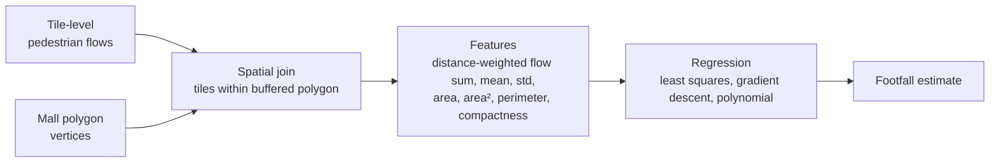

# Estimating Shopping-Mall Footfall from Mobile-Phone Pedestrian Flows

> CentraleSupélec · AI track · Client: **MyTraffic** (footfall-analytics startup) · 2023 · Team of 5

**TL;DR**: MyTraffic turns mobile-network GPS pings into pedestrian flows on a nationwide grid of tiles. The data is aggregated so that it stays GDPR-compliant, because raw location data must be deleted after 3 months. The client's question: **how much footfall does a shopping mall get if it is not yet in their database?** We built a geospatial feature pipeline and regression models that estimate a mall's footfall from the shape of its polygon and the surrounding street flows. With only ~10 labeled malls, the model gives a **useful order of magnitude**: R² ≈ 0.81 in-sample, with leave-one-out errors from ~20% to much larger. Most of the work was about extracting signal from very small data and being honest about its limits.

Code and data are not published: the client's data is confidential.

---

## Business problem

MyTraffic's retail clients choose store locations and evaluate acquisitions using footfall estimates. Street-level pedestrian flows were available. Footfall *inside* a mall was only known for malls whose owners shared their counts.

**Question:** given only a mall's outline (a polygon) and the tile-level pedestrian flows around it, can we infer its footfall and rebuild its history?

## Approach

1. **Geospatial pipeline.** We computed polygon geometry with Shapely, then **buffered** each polygon so that flows on adjacent streets are also captured. Flows from the tiles inside the buffered polygon are then aggregated.
2. **Distance weighting.** Each tile is weighted by its distance to the polygon's centroid, relative to the farthest boundary point. The assumption is that passers-by near the core of the mall are more likely to enter.
3. **Feature engineering.** For each polygon we computed:
   - the weighted flow sum, mean flow and standard deviation;
   - area, area² and perimeter;
   - a **compactness index**: the polygon's area compared with a circle of the same perimeter. It separates regular mall footprints from irregular ones.
4. **Models.** We fitted the following, in order:
   - ordinary least squares;
   - linear regression by **gradient descent implemented from scratch**, validated on a toy problem;
   - polynomial regression with scikit-learn;
   - a size-based split into two models, abandoned because each half had too few samples;
   - **leave-one-out cross-validation** to make the most of the data.
5. **Client-facing visualization.** We built interactive Folium maps with marker clusters and heatmap layers, so the client can see where pedestrian flows concentrate around a site.

## Results

| Model | Result |
|---|---|
| 7-feature linear regression | R² = 0.81 (in-sample, 6 malls with non-zero footfall) |
| Leave-one-out cross-validation | Held-out error from ~20% on some malls to very large on others |

The model is good enough to give an **order of magnitude** that can be applied to any polygon in France. It is not reliable enough for site-level decisions.

## What I learned

- **Small data calls for honest evaluation.** In-sample R² on 6 points is close to meaningless. Out-of-sample error (LOOCV) is the number to report, even when it hurts.
- **Scope with the client early.** In hindsight, the most valuable move would have been to agree upfront on the target accuracy and to ask for more labeled malls, before building features.
- **Simple, explainable models first.** With ~10 samples, a physically motivated model (flow × capture rate) with uncertainty bands would be more defensible than adding features.

## My contribution

[to fill in]

## Stack

`Python` · `Shapely` · `Folium` · `NumPy` · `scikit-learn`
